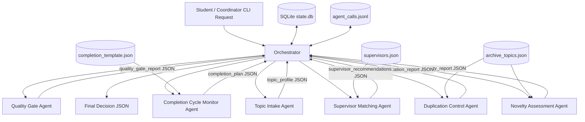

# Architecture

## Interaction Pattern

The prototype uses an **orchestrator + pipeline** pattern with explicit shared state.

- The orchestrator creates the task, sends JSON messages, records state, and enforces step limits.
- Domain agents perform only their own specialized work.
- All messages and results are stored in SQLite and JSONL logs.
- Agents use local tools and data sources: archived project topics, supervisor profiles, completion milestone templates, and the SQLite state store.

## Architecture Diagram

## Typical Scenario Flow

1. A student submits a topic, department, student name, and optional keywords.
2. Topic Intake Agent validates the request and produces a normalized topic profile.
3. Novelty Assessment Agent compares the topic against archived topics and returns a novelty score.
4. Duplication Control Agent classifies the duplication risk.
5. Supervisor Matching Agent ranks suitable supervisors.
6. Completion Cycle Monitor Agent builds a basic milestone plan.
7. Quality Gate Agent checks whether the topic can move to teacher review.
8. The orchestrator returns a final JSON report and records all messages.

## Load Balance for Assignment 2 Prototype

The typical run calls each domain agent once:

| Agent | Calls | Share |
| --- | ---: | ---: |
| Topic Intake Agent | 1 | 16.7% |
| Novelty Assessment Agent | 1 | 16.7% |
| Duplication Control Agent | 1 | 16.7% |
| Supervisor Matching Agent | 1 | 16.7% |
| Completion Cycle Monitor Agent | 1 | 16.7% |
| Quality Gate Agent | 1 | 16.7% |

No domain agent performs more than 40% of all agent calls.
