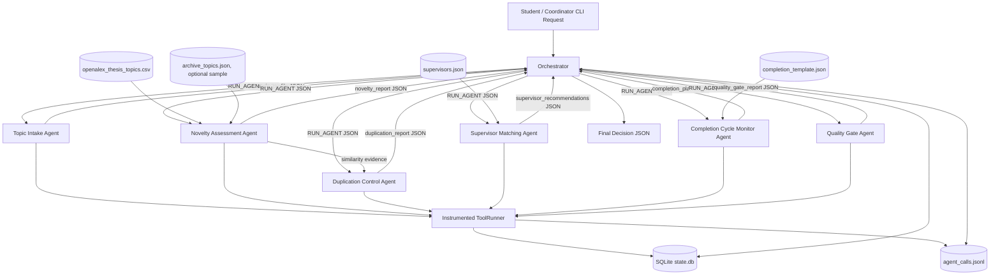

# Architecture

## Interaction Pattern

The prototype uses an **orchestrator + pipeline** pattern with explicit shared state.

- The orchestrator creates the task, sends JSON messages, records state, and enforces step/time limits and retry policy.
- Domain agents perform only their own specialized work.
- Request and result messages are stored in SQLite. Agent and tool call events are stored in SQLite and JSONL.
- Agents use local tools and datasets: the bundled OpenAlex CSV topic archive, supervisor profiles, and completion milestone templates. The orchestrator and ToolRunner use SQLite for state and call events.

## Architecture Diagram

## Typical Scenario Flow

1. A student submits a topic, department, student name, and optional keywords.
2. Topic Intake Agent validates the request and produces a normalized topic profile.
3. Novelty Assessment Agent loads the CSV archive, excludes synthetic variants by default, and compares the topic against 160 OpenAlex records. It returns a novelty score, archive counts, and source links.
4. Duplication Control Agent classifies the duplication risk.
5. Supervisor Matching Agent ranks suitable supervisors.
6. Completion Cycle Monitor Agent builds a basic milestone plan.
7. Quality Gate Agent checks whether the topic can move to teacher review.
8. The orchestrator returns a final JSON report and records all messages.

## Load Balance for Assignment 4 Typical Run

The typical run calls each domain agent once. ToolRunner records each actual tool invocation:

| Agent | Tool calls | Share |
| --- | ---: | ---: |
| Topic Intake Agent | 2 | 20% |
| Novelty Assessment Agent | 2 | 20% |
| Duplication Control Agent | 1 | 10% |
| Supervisor Matching Agent | 2 | 20% |
| Completion Cycle Monitor Agent | 2 | 20% |
| Quality Gate Agent | 1 | 10% |

No domain agent performs more than 40% of tool/LLM calls in the typical run. No LLM is configured, so the denominator is 10 actual tool calls. Retry attempts count toward load. See `artifacts/assignment4_demo_calls.jsonl`.
